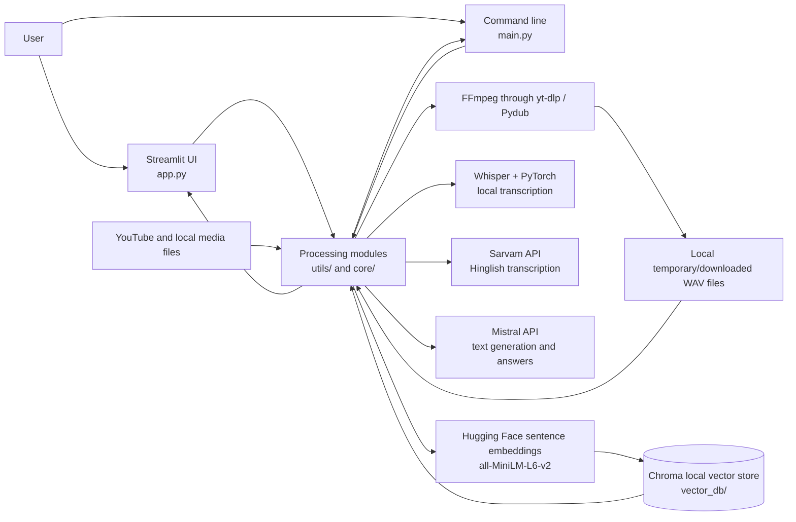
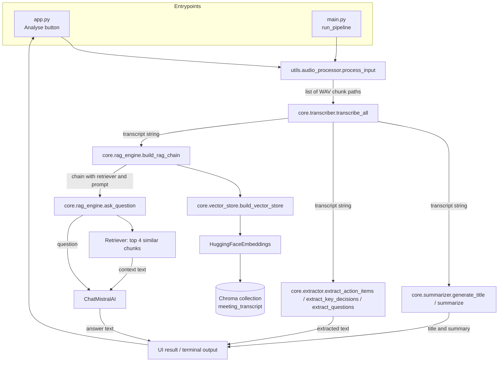

# Project Architecture

## 1. Overall architecture

The project is a small, modular Python application that runs as one process. It has two entry points: a Streamlit browser UI (`app.py`) and an interactive command-line interface (`main.py`). Both coordinate the same processing modules. There is no separate frontend application calling a backend API, no standalone backend service, and no user authentication layer.

The processing flow is mostly synchronous: a user submits a recording, the application processes it step by step, calls local tools and external AI services, then returns results to the UI or terminal. Streamlit maintains UI state in its own session state. Chroma persists transcript vectors on the local filesystem in `vector_db/`; it is not a remote database service. Configuration caveat: `app.py` and `main.py` call `load_dotenv()` after importing core modules, while `core/transcriber.py` reads `SARVAM_API_KEY` at import time, so a `.env`-only Sarvam key may not be captured in those entry points.

## 2. High-level system architecture



### Diagram components

- **User:** Supplies a YouTube URL or local media path, chooses a transcription language in the UI/CLI, and can ask transcript questions.
- **Streamlit UI (`app.py`):** Renders the form, progress indicators, generated notes, transcript, and chat. It invokes processing functions directly.
- **CLI (`main.py`):** Prompts for input, calls `run_pipeline()`, prints generated notes, and loops for questions.
- **Processing modules (`utils/`, `core/`):** Download/convert/chunk media, transcribe it, generate notes, index the transcript, and answer questions.
- **Media source:** The input is either a URL (the code treats any `http://` or `https://` string as a YouTube source) or a local path.
- **FFmpeg/Pydub/yt-dlp:** `utils/audio_processor.py` uses yt-dlp for URL downloads and Pydub for local conversion/chunking. FFmpeg is used by the media operations as an external executable.
- **Whisper + PyTorch:** Local English speech recognition, selected by `core/transcriber.py` for the `english` option.
- **Sarvam API:** Remote speech transcription/translation for `hinglish`, called from `core/transcriber.py` with `requests`.
- **Mistral API:** Hosted language model called through `ChatMistralAI` in the summarizer, extractor, and RAG modules.
- **Hugging Face embeddings:** Converts transcript chunks and questions into vectors for semantic retrieval.
- **Chroma:** Local vector store built by `core/vector_store.py`, persisted in `vector_db/`.
- **Local media files:** Downloaded, converted, chunked, and temporary audio files are written locally (downloads use the source's `downloades/` directory).

## 3. Layers and responsibilities

| Layer | Main modules | Responsibility |
|---|---|---|
| Presentation / entry points | `app.py`, `main.py` | Collect input, invoke the pipeline, display/print results, accept questions, and keep UI/chat state. |
| Orchestration | Streamlit pipeline block in `app.py`; `run_pipeline()` in `main.py` | Call each processing step in order and assemble the result dictionary. |
| Media preparation | `utils/audio_processor.py` | Download YouTube audio or convert local input, normalize local media to mono 16 kHz WAV, and split into ten-minute chunks. |
| Transcription | `core/transcriber.py` | Choose Whisper or Sarvam based on language and combine chunk transcripts. |
| Language-model tasks | `core/summarizer.py`, `core/extractor.py` | Ask Mistral for a title, summary, action items, decisions, and unresolved questions. |
| Retrieval and persistence | `core/vector_store.py`, `core/rag_engine.py` | Embed and store transcript chunks; retrieve relevant chunks and compose a contextual answer. |
| External/local infrastructure | yt-dlp, FFmpeg, Whisper, Sarvam, Mistral, sentence-transformers, Chroma | Provide media access, speech recognition, text generation, embeddings, and vector persistence. |

These are logical responsibilities within one application, not independently deployed services. The backend logic is implemented by Python modules and called directly by the UI/CLI.

## 4. Component interaction



### Diagram components

- **Entry points:** The UI and CLI each begin orchestration. The UI spells out the processing steps in its button handler; the CLI delegates most steps to `run_pipeline()`.
- **`process_input()`:** Returns a list of audio chunk paths.
- **`transcribe_all()`:** Processes each path and returns one transcript string.
- **`generate_title()` / `summarize()`:** Transform the transcript into presentation text using Mistral.
- **Extractor functions:** Each builds a prompt chain and returns a string with the requested meeting information.
- **`build_rag_chain()`:** Builds a vector store and returns a LangChain pipeline for answering questions.
- **`build_vector_store()`:** Splits text, creates LangChain `Document` objects, embeds them, and creates the Chroma collection.
- **Retriever:** Chroma's similarity search returns up to four transcript chunks.
- **`ask_question()`:** Invokes the chain with the raw user question; retrieved text is inserted into the prompt by the chain.
- **Mistral:** Receives the relevant context and question for an answer, which the UI or CLI presents.

The diagram shows the logical call/data relationships; the exact order in each entry point is listed below.

## 5. Request and response flow

```mermaid
sequenceDiagram
    actor User
    participant Entry as app.py or main.py
    participant Audio as utils.audio_processor
    participant Speech as core.transcriber
    participant Notes as core.summarizer and core.extractor
    participant RAG as core.rag_engine
    participant Vectors as core.vector_store / Chroma
    participant Model as Mistral API
    participant View as Streamlit UI or CLI

    User->>Entry: Submit media path/URL and language
    Entry->>Audio: process_input(source)
    Audio->>Audio: Download or convert; split WAV into chunks
    Audio-->>Entry: list of chunk paths
    Entry->>Speech: transcribe_all(chunks, language)
    Speech->>Speech: Whisper locally OR send 25-second pieces to Sarvam
    Speech-->>Entry: transcript string
    Entry->>Model: generate_title(transcript)
    Model-->>Entry: title
    Entry->>Notes: summarize(transcript)
    Notes->>Model: Summarize transcript chunks, then combine
    Model-->>Notes: partial and final summaries
    Notes-->>Entry: summary
    Entry->>Notes: extract action items, decisions, questions
    Notes->>Model: Three prompt-chain calls
    Model-->>Notes: extracted text
    Notes-->>Entry: action items, decisions, questions
    Entry->>RAG: build_rag_chain(transcript)
    RAG->>Vectors: Split/embed transcript and create Chroma store
    Vectors-->>RAG: vector store and retriever
    RAG-->>Entry: question-answer chain
    Entry-->>View: Display title, transcript, summary, and extracted notes
    User->>Entry: Ask a question
    Entry->>RAG: ask_question(chain, question)
    RAG->>Vectors: Similarity search (k=4)
    Vectors-->>RAG: matching transcript chunks
    RAG->>Model: Prompt with retrieved context and question
    Model-->>RAG: answer text
    RAG-->>Entry: answer
    Entry-->>User: Display/print answer
```

### Flow notes

1. In `app.py`, the Analyze button handler validates that the source is non-empty, resets the prior result/chat, updates step status, and runs processing in a `try` block. `main.py` prompts for source/language and calls `run_pipeline()`.
2. `process_input()` decides URL versus local file, performs media conversion/download, and returns chunk paths. The paths are intermediate data; the transcript string becomes the input to all later analysis features.
3. `transcribe_all()` processes chunks serially. English goes through `transcribe_chunk_whisper()` and a cached module-level Whisper model. Hinglish goes through `transcribe_chunk_sarvam()`, which creates and deletes short temporary WAV pieces around each Sarvam request.
4. Title, summary, and extraction calls each use Mistral through separate LangChain chains. The summary uses 3,000-character chunks with 200-character overlap, then combines partial summaries. Title generation uses only the first 2,000 transcript characters.
5. RAG indexing splits the full transcript into 500-character chunks with 50-character overlap and persists them to the Chroma directory. The RAG chain uses the current in-memory vector store and retrieves four similar chunks per question.
6. The answer is displayed in Streamlit or printed by the CLI. The UI appends user/assistant messages to `st.session_state.chat_history`; the model chain itself is given each question and retrieved transcript context, not the prior chat history.

## 6. Data movement and business logic

The key data types passed between modules are simple Python values:

- **Source:** A string URL or local path from the UI text input or CLI prompt.
- **Audio chunks:** A list of WAV path strings returned by `process_input()`.
- **Transcript:** A single string returned by `transcribe_all()` and passed to summarization, extraction, and RAG indexing.
- **Analysis outputs:** Strings (`title`, `summary`, `action_items`, `key_decisions`, `open_questions`) assembled in a dictionary by the entry point.
- **RAG artifacts:** LangChain `Document` objects, vector embeddings, a Chroma vector store/retriever, and a runnable chain.
- **Chat input/output:** A question string is passed to `ask_question()`, which returns an answer string.

Business logic is primarily in `core/`: transcription selection and aggregation (`transcriber.py`), summary strategy (`summarizer.py`), prompt definitions (`extractor.py`), vector indexing (`vector_store.py`), and grounded answer pipeline (`rag_engine.py`). `utils/audio_processor.py` owns media-specific logic. Entry points coordinate these functions and control presentation; they do not expose a separate business API.

## 7. Module dependencies

```text
app.py ─┬─> utils.audio_processor
        ├─> core.transcriber
        ├─> core.summarizer
        ├─> core.extractor
        └─> core.rag_engine ──> core.vector_store

main.py ─┬─> utils.audio_processor
         ├─> core.transcriber
         ├─> core.summarizer
         ├─> core.extractor
         └─> core.rag_engine ──> core.vector_store
```

- `app.py` and `main.py` depend on feature modules directly. The CLI groups them behind `run_pipeline()`; the UI explicitly calls them to update per-step status.
- `core.rag_engine` imports `build_vector_store`, `load_vector_store`, and `get_retriever` from `core.vector_store`.
- `core.summarizer`, `core.extractor`, and `core.rag_engine` each configure their own `ChatMistralAI` instance rather than sharing a common model/configuration module.
- `core.transcriber` depends on `pydub` for Sarvam audio slicing and on `requests` for HTTP; it selects between local Whisper and Sarvam.
- No module calls another over HTTP within the project; these are in-process Python function calls. HTTP is used only to reach external services.

One alternate path, `load_rag_chain()` in `core/rag_engine.py`, appears intended to reopen a stored Chroma collection, but it calls `get_retriever()` without the required vector-store argument. The main UI and CLI use `build_rag_chain(transcript)` instead, so this load path is not part of their working request flow.

## 8. Design patterns present in the code

- **Modular separation by responsibility:** Audio, transcription, summarization, extraction, and retrieval logic are placed in separate modules. This is visible in the imports from `app.py` and `main.py`.
- **Pipeline / sequential orchestration:** The application applies a fixed series of transformations: source → WAV chunks → transcript → notes and RAG index. The steps are explicit in `app.py` and `run_pipeline()`.
- **Strategy-like selection:** `transcribe_chunk()` chooses Whisper or Sarvam from the language parameter. The implementations are separate functions, but there is no formal strategy class or plugin interface.
- **Adapter/composition via LangChain:** `ChatMistralAI`, Chroma, embeddings, retrievers, prompts, and output parsers are composed into runnable chains. This is framework composition, not a custom adapter architecture.
- **Map-then-combine summarization:** `summarize()` summarizes transcript chunks separately and then combines the intermediate summaries. This behavior is implemented directly in `core/summarizer.py`.

There is no evidence of a repository, controller/service framework, dependency injection container, event bus, microservice architecture, or formal MVC structure. Those labels should not be applied to this code as written.

## 9. Why this architecture appears to have been chosen

The source supports a few grounded conclusions:

- Having both `app.py` and `main.py` call the same processing modules gives the project both an interactive UI and a terminal path without duplicating the processing implementations.
- Separating media preparation from AI tasks isolates specialized operations such as FFmpeg conversion and speech recognition from prompts and retrieval.
- Chunking is used to make long media and transcripts processable: audio is split into ten-minute files, Sarvam's input into 25-second pieces, summaries into 3,000-character chunks, and retrieval documents into 500-character chunks.
- The local Whisper model and local Chroma persistence keep English transcription and vector storage on the machine, while Mistral and Sarvam provide hosted AI capabilities.
- LangChain LCEL makes the prompt/retrieval/model steps composable in the existing Python application.

These are inferences from implementation choices, not stated design goals. The code remains a single-process application with sequential work and local filesystem state; it does not implement independent scaling, job queues, or a distributed service boundary.
