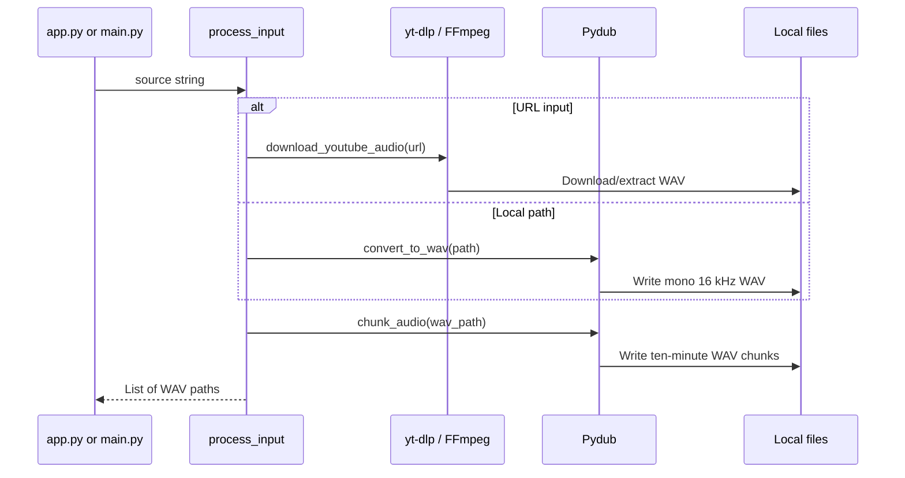
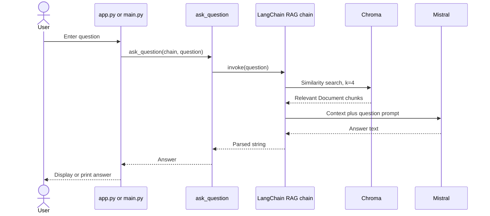

# Project Workflows

This document follows the current implementation in `app.py`, `main.py`, `utils/`, and `core/`. The application has two entry points, but both use the same processing functions. “Database” operations below refer to the local Chroma vector store; the project has no relational database.

## 1. Analyze a recording in the Streamlit UI

1. **What it does:** Runs the complete analysis and displays a title, transcript, summary, action items, decisions, open questions, and transcript chat.
2. **Why it is needed:** It is the main user-facing path for turning a recording into reviewable notes.
3. **Trigger:** The user enters a URL or local file path, selects `english` or `hinglish`, and clicks **Analyse** in the sidebar.
4. **Receiving function:** The button handler in `app.py` calls processing functions directly; there is no HTTP backend endpoint.
5. **Internal steps:** It checks that the source is non-empty; clears previous result and chat state; then calls `process_input()`, `transcribe_all()`, `generate_title()`, `summarize()`, each extraction function, and `build_rag_chain()` in order. It stores the outputs in `st.session_state.result`, marks the pipeline complete, and reruns Streamlit to render results.
6. **Data:** Source string → list of chunk WAV paths → transcript string → generated strings and RAG chain. The status map is kept in `st.session_state.pipeline_steps`.
7. **Database operations:** `build_rag_chain()` creates embeddings and writes transcript chunks to the local Chroma collection in `vector_db/`. Other analysis steps do not use a database.
8. **Response:** The UI shows title, summary, expandable transcript, extraction cards, and a chat area.
9. **Errors:** Empty input gives a Streamlit error before processing. The full pipeline is inside `try/except Exception`; on failure the UI displays the exception message and resets any currently active step to pending. It does not roll back media files or Chroma writes already completed.
10. **Code:** `app.py` (Analyze handler and results rendering), `utils/audio_processor.py:process_input`, `core/transcriber.py:transcribe_all`, `core/summarizer.py:generate_title` and `summarize`, `core/extractor.py`, `core/rag_engine.py:build_rag_chain`.

```mermaid
sequenceDiagram
    actor User
    participant UI as app.py
    participant Audio as process_input
    participant STT as transcribe_all
    participant Notes as summarizer / extractor
    participant RAG as build_rag_chain
    participant DB as Chroma
    User->>UI: Enter source/language; click Analyse
    UI->>Audio: process_input(source)
    Audio-->>UI: WAV chunk paths
    UI->>STT: transcribe_all(chunks, language)
    STT-->>UI: transcript
    UI->>Notes: title, summary, action items, decisions, questions
    Notes-->>UI: generated text results
    UI->>RAG: build_rag_chain(transcript)
    RAG->>DB: Embed and store transcript chunks
    DB-->>RAG: vector store
    RAG-->>UI: runnable QA chain
    UI-->>User: Render analysis results
```

## 2. Download or convert and chunk audio

1. **What it does:** Produces WAV chunk files from an input URL or local media path.
2. **Why it is needed:** The transcription modules operate on audio file paths, while the user may provide video or audio in other formats.
3. **Trigger:** `process_input(source)` is called from the UI or CLI analysis workflow.
4. **Receiving function:** `utils/audio_processor.py:process_input`.
5. **Internal steps:** If the source starts with `http://` or `https://`, it calls `download_youtube_audio()`, which invokes yt-dlp and configures FFmpeg audio extraction to WAV. Otherwise, it calls `convert_to_wav()`, which uses Pydub to decode the file, set mono and 16 kHz, then exports WAV. It next calls `chunk_audio()`, which reads the WAV and writes consecutive ten-minute WAV segments.
6. **Data:** A source string becomes a local WAV path, then a list of chunk path strings. The module-level `DOWNLOAD_DIR` is the literal `downloades` and is created on import.
7. **Database operations:** None. Files are created on disk; no cleanup of the downloaded/converted/chunk files is implemented here.
8. **Response:** `process_input()` returns the list of chunk paths.
9. **Errors:** There is no local try/except in this module. Download, unsupported format, missing source file, or FFmpeg failures propagate to the caller. In the UI they are caught by the overall pipeline handler; in CLI they terminate the command unless handled externally.
10. **Code:** `utils/audio_processor.py:process_input`, `download_youtube_audio`, `convert_to_wav`, `chunk_audio`.



## 3. Transcribe audio chunks

1. **What it does:** Converts the chunk WAV files into one transcript string.
2. **Why it is needed:** Every downstream AI feature consumes transcript text rather than raw audio.
3. **Trigger:** The main analysis workflow calls `transcribe_all(chunks, language)` after audio preparation.
4. **Receiving function:** `core/transcriber.py:transcribe_all`.
5. **Internal steps:** Iterates chunk paths in order and calls `transcribe_chunk()` for each. For English, `transcribe_chunk_whisper()` loads the Whisper model once through `load_model()` and transcribes locally. For Hinglish, `transcribe_chunk_sarvam()` opens each ten-minute chunk with Pydub, slices it into 25-second WAV files, calls `_send_to_sarvam()` for each piece, appends returned transcripts, and deletes temporary pieces in a `finally` block.
6. **Data:** Chunk paths → transcript snippets → a joined transcript string. Sarvam responses are read from the JSON `transcript` field.
7. **Database operations:** None.
8. **Response:** `transcribe_all()` returns the combined transcript string.
9. **Errors:** Missing `SARVAM_API_KEY` raises `RuntimeError`. A non-success Sarvam response prints its status/body and calls `raise_for_status()`. Network errors and Whisper/model/file errors propagate. Temporary Sarvam pieces are deleted even when their request fails; original chunk files remain. UI catches failures at pipeline level; CLI does not.
10. **Code:** `core/transcriber.py:transcribe_all`, `transcribe_chunk`, `load_model`, `transcribe_chunk_whisper`, `transcribe_chunk_sarvam`, `_send_to_sarvam`.

```mermaid
sequenceDiagram
    participant Caller
    participant All as transcribe_all
    participant Route as transcribe_chunk
    participant Whisper as Local Whisper
    participant Sarvam as Sarvam API
    participant Pydub
    Caller->>All: chunks, language
    loop Each ten-minute WAV chunk
        All->>Route: transcribe_chunk(chunk, language)
        alt english
            Route->>Whisper: load model if needed; transcribe WAV
            Whisper-->>Route: text
        else hinglish
            Route->>Pydub: Split into 25-second WAV pieces
            loop Each piece
                Route->>Sarvam: _send_to_sarvam(piece)
                Sarvam-->>Route: English transcript
            end
            Route->>Pydub: Delete temporary piece files
        end
        Route-->>All: chunk transcript
    end
    All-->>Caller: Joined transcript
```

## 4. Generate title and summary

1. **What it does:** Creates a short title and a combined bullet-point summary.
2. **Why it is needed:** The title labels the analyzed recording; the summary condenses longer transcript content for quicker review.
3. **Trigger:** Both entry points call the functions after transcription.
4. **Receiving functions:** `core/summarizer.py:generate_title` and `summarize`.
5. **Internal steps:** Both create a `ChatMistralAI` wrapper configured for `mistral-small-latest` and `MISTRAL_API_KEY`. `generate_title()` sends only the first 2,000 transcript characters through a prompt asking for at most eight words. `summarize()` splits the full transcript with `RecursiveCharacterTextSplitter` using 3,000-character chunks and 200-character overlap; it asks Mistral for a summary of each chunk, joins partial summaries, then asks Mistral to combine them into professional bullet points.
6. **Data:** Transcript string → prompt input(s) → Mistral output strings. Summary calls happen sequentially in a list comprehension.
7. **Database operations:** None.
8. **Response:** Title and summary strings are added to the result payload and displayed/printed.
9. **Errors:** There are no local retries or exception handlers. Missing/invalid credentials, API failures, or empty/problematic model responses propagate to the entry point. The UI's pipeline handler displays the error; CLI fails uncaught.
10. **Code:** `core/summarizer.py:get_llm`, `split_transcript`, `generate_title`, `summarize`; callers in `app.py` and `main.py`.

## 5. Extract action items, decisions, and open questions

1. **What it does:** Asks the language model to identify three kinds of meeting information.
2. **Why it is needed:** Converts free-form conversation into follow-up and decision-oriented notes.
3. **Trigger:** The analysis flow calls the three extractor functions after summary generation.
4. **Receiving functions:** `extract_action_items()`, `extract_key_decisions()`, and `extract_questions()` in `core/extractor.py`.
5. **Internal steps:** Each function supplies a task-specific system prompt to `build_chain()`. `build_chain()` constructs a Mistral model at temperature 0.2 and composes input mapping, `ChatPromptTemplate`, model invocation, and `StrOutputParser`. The action prompt requests task, owner, and deadline; the decision and question prompts request numbered lists. Each chain is invoked once with the complete transcript.
6. **Data:** Full transcript string → three separate prompts/API requests → three plain text strings.
7. **Database operations:** None.
8. **Response:** Three extraction strings, displayed in separate UI cards or printed in CLI output. Prompts instruct the model to return a “none found” message if appropriate; this is model output, not an application-side check.
9. **Errors:** No local error handling or retries. Model/API exceptions propagate to the outer UI pipeline handler or uncaught CLI caller.
10. **Code:** `core/extractor.py:get_llm`, `build_chain`, `extract_action_items`, `extract_key_decisions`, `extract_questions`.

## 6. Index transcript in Chroma and build question-answer chain

1. **What it does:** Creates semantic search over transcript chunks and returns a runnable RAG chain (retrieval-augmented generation).
2. **Why it is needed:** Supplies relevant transcript passages to the model when the user asks a follow-up, reducing reliance on a model's unsupported recall.
3. **Trigger:** The analysis flow calls `build_rag_chain(transcript)` after notes/extraction.
4. **Receiving function:** `core/rag_engine.py:build_rag_chain`.
5. **Internal steps:** Calls `build_vector_store(transcript)`. That function splits text into 500-character chunks with 50-character overlap, wraps each as a LangChain `Document` with a `chunk_index`, creates CPU Hugging Face embeddings with `all-MiniLM-L6-v2`, and calls `Chroma.from_documents()`. `build_rag_chain()` obtains a similarity retriever configured for `k=4`, creates a Mistral chat model and prompt, then composes a chain that retrieves and formats context, passes through the question, invokes the prompt/model, and parses a string response.
6. **Data:** Transcript → document chunks and vectors → stored collection; chain object returned to the entry point and stored in Streamlit result state or CLI result dictionary.
7. **Database operations:** Writes documents/embeddings to Chroma collection `meeting_transcript` in `vector_db/`. There is no explicit collection clearing, update, or delete in the code. Each build calls `Chroma.from_documents()` against that collection; repeated-run behavior may therefore leave prior documents in the same collection depending on Chroma's ID/collection behavior.
8. **Response:** A LangChain runnable chain, not an answer yet.
9. **Errors:** Embedding model download/load failures, Chroma filesystem problems, and configuration errors propagate. UI catches them as pipeline errors; CLI does not. The RAG prompt asks the model to say it cannot find information if context lacks an answer, but no programmatic verification is performed.
10. **Code:** `core/rag_engine.py:build_rag_chain`, `get_llm`, `format_docs`; `core/vector_store.py:build_vector_store`, `get_embeddings`, `get_retriever`.

## 7. Ask a question about the transcript

1. **What it does:** Retrieves transcript chunks relevant to a question and asks Mistral to answer using those chunks.
2. **Why it is needed:** Lets users query information in the analyzed recording conversationally.
3. **Trigger:** In the UI, user enters a nonblank question and clicks **Send**. In the CLI, user types a nonblank question at the prompt.
4. **Receiving function:** `core/rag_engine.py:ask_question(rag_chain, question)`.
5. **Internal steps:** `ask_question()` logs the question, invokes the passed chain. The chain runs its Chroma retriever on the question, formats returned documents with `format_docs()`, fills the prompt's `{context}` and `{question}`, invokes Mistral, parses a string, logs and returns the answer.
6. **Data:** Question string → embedding/similarity search → up to four retrieved document texts → prompt → answer string. The UI chat history is not supplied to this chain; each request is grounded in retrieved transcript content, not prior turns.
7. **Database operations:** Chroma is read through similarity search. No database write is performed by an individual question.
8. **Response:** `ask_question()` returns the answer string. Streamlit appends user and assistant messages to `st.session_state.chat_history` and reruns; CLI prints the result. The UI's Clear Chat button clears only in-memory chat history.
9. **Errors:** `ask_question()` has no exception handling. In the UI, the call is inside a spinner but outside the pipeline's `try/except`, so request-time chat errors are not caught by that pipeline handler. CLI errors also propagate. Blank questions are ignored by the UI and CLI loops.
10. **Code:** `core/rag_engine.py:ask_question`, chain assembled by `build_rag_chain`, `core/vector_store.py:get_retriever`; UI handler in `app.py`; CLI loop in `main.py`.



## 8. Run the command-line workflow

1. **What it does:** Offers the same core analysis and chat through terminal prompts and printed output.
2. **Why it is needed:** Allows use without the Streamlit browser interface and provides a simple scriptable entry point.
3. **Trigger:** Run `python main.py`.
4. **Receiving function:** The `if __name__ == "__main__"` block prompts for a source and language, then calls `run_pipeline(source, language)`.
5. **Internal steps:** `run_pipeline()` calls audio processing, transcription, title generation, summary generation, all three extractors, and RAG chain construction. It returns a dictionary. The entry-point code prints notes and loops for chat until the user enters `exit`, `quit`, or `q`.
6. **Data:** Uses the same values and local/remote integrations described above. The result dictionary includes the runnable `rag_chain` object as well as text fields.
7. **Database operations:** Builds and writes the transcript vectors to Chroma during pipeline execution; question turns read via similarity search.
8. **Response:** Printed title, summary, action items, decisions, questions, and answers.
9. **Errors:** There is no broad exception handler in `main.py`. Failures from file handling, transcription, API calls, or Chroma generally terminate the current run.
10. **Code:** `main.py:run_pipeline` and `main.py` main block.

## 9. Example script workflow (`test.py`)

`test.py` is a demonstration script rather than an automated test suite. When run, it loads `.env`, uses a fixed YouTube URL and `english`, invokes media preparation, transcription, title/summary generation, and extraction, and prints the results. It does not build the RAG chain or ask questions. It has no assertions, test framework fixtures, or local exception handling. Code: `test.py` and the functions it imports from `utils/audio_processor.py`, `core/transcriber.py`, `core/summarizer.py`, and `core/extractor.py`.

## Persistence and error-handling summary

- **Persistent data:** Downloaded/converted/chunked audio files are written under local paths; the source does not remove them. Chroma persists embeddings/documents in `vector_db/`. Sarvam's temporary 25-second WAV pieces are removed after each request attempt.
- **Transient state:** Streamlit results and chat messages are in `st.session_state`; CLI results live in process memory. No user or conversation records are stored in a relational database.
- **Error boundaries:** Only the Streamlit analysis pipeline has a broad application-level `try/except`. Individual feature modules mostly let exceptions propagate. Chat actions are outside that analysis handler. CLI and `test.py` have no broad catch.
- **Not implemented:** There is no asynchronous job queue, retry policy, explicit Chroma cleanup, export workflow, login, or API endpoint for external clients in the inspected code.
