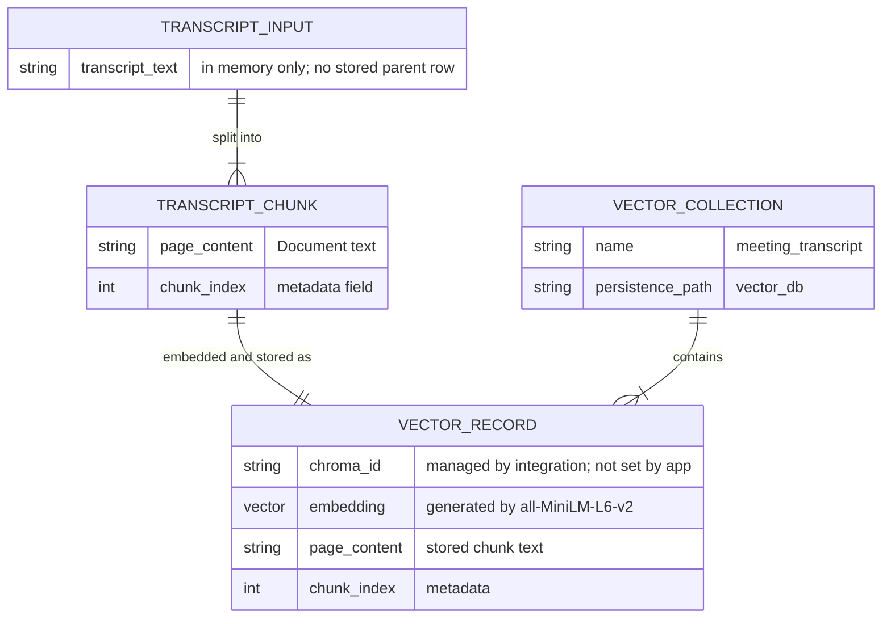

# Database Design

## Summary

The project uses **Chroma**, a local persistent vector store, for transcript retrieval in its question-answering feature. It does not use a relational database, SQL tables, ORM, or application-managed relational schema. The source creates one named Chroma collection and stores transcript text chunks with embeddings and metadata. Chroma's own internal storage details are not defined by this repository.

The configured persistence directory is `vector_db/`, relative to the process working directory. It may be created when the application builds the vector store; it is runtime data, not a checked-in database schema.

## 1. Database and purpose

Chroma is used because the RAG feature needs semantic similarity search: retrieve transcript passages that are conceptually relevant to a question. `core/vector_store.py` uses the LangChain Chroma adapter (`langchain_chroma.Chroma`) and embeddings from `HuggingFaceEmbeddings` using `all-MiniLM-L6-v2` on CPU.

A relational database would store structured records and support joins/filters. The code instead embeds text and asks Chroma for the nearest transcript chunks. There is no ORM or SQL query layer in the source.

## 2. Collection and record shape

The only explicitly configured collection is:

- **Collection:** `meeting_transcript`
- **Persistence path:** `vector_db`
- **Configured embedding model:** `all-MiniLM-L6-v2`

For each text chunk, `build_vector_store()` creates a LangChain `Document` like this:

```python
Document(
    page_content=chunk,
    metadata={"chunk_index": i},
)
```

Conceptually, a stored Chroma record contains:

| Value | Source-level representation | Meaning |
|---|---|---|
| Record identifier | Chroma-managed; not supplied in source | Identifies a stored vector record. The application does not define or retain IDs explicitly. |
| Text | `Document.page_content` (string) | One transcript excerpt, split to roughly 500 characters with 50-character overlap. |
| Metadata | `Document.metadata` with `chunk_index` (integer) | Index assigned by `enumerate()` within the current transcript's chunks. No meeting/session identifier is included. |
| Embedding | Generated by `HuggingFaceEmbeddings` | Numeric vector derived from the chunk text; dimension/storage format is delegated to the model and Chroma integration. |

The exact physical table layout and internal Chroma indexes are not declared in the project. The table above describes the logical record passed to Chroma, not Chroma's internal schema.

## 3. ER-style diagram

This diagram shows the application's logical vector data, not relational tables. A “transcript” is an input string in memory; the application does not persist a transcript parent row or a transcript ID. Chroma may assign internal record IDs, but the application does not define them.



### Relationships

- One transcript input is divided into many text chunks (one-to-many, during indexing).
- Each chunk is embedded into a vector record (conceptually one-to-one for that indexing operation).
- The named Chroma collection contains many vector records (one-to-many).
- There are no implemented foreign keys or persistent relationship from a vector record back to a transcript parent. `chunk_index` is only a metadata value and is not a foreign key.
- No one-to-one or many-to-many relational relationships are implemented. The ER notation is only a conceptual view of chunk indexing.

## 4. Keys, indexes, constraints, and validation

### Keys

- No primary key is declared in project code. Chroma manages vector record identifiers internally; the code does not pass explicit IDs to `Chroma.from_documents()`.
- No foreign keys exist because there are no relational tables or parent transcript records.

### Indexes

- The source does not create or configure database indexes directly.
- `get_retriever()` requests Chroma similarity search with `search_type="similarity"` and `k=4`. The vector store's internal nearest-neighbor indexing/search behavior is delegated to Chroma; the repository does not specify its index type or parameters.
- No metadata filter, keyword index, or index on `chunk_index` is requested.

### Constraints and validation

- There are no application-defined schema constraints such as `NOT NULL`, uniqueness, checks, or referential integrity.
- Chunk size and overlap are application-side splitting settings: 500 and 50 characters in `build_vector_store()`.
- `chunk_index` is assigned by `enumerate()` and is an integer, but no database constraint enforces its range or uniqueness.
- No validation checks for empty transcripts, duplicate chunks, maximum collection size, or that existing vectors use the same embedding model.

## 5. Actual database operations

All database-related operations appear in `core/vector_store.py` and are coordinated by `core/rag_engine.py`.

### Insert/build

`core/vector_store.py:build_vector_store(transcript)`:

1. Splits transcript with `RecursiveCharacterTextSplitter(chunk_size=500, chunk_overlap=50)`.
2. Creates one `Document` per chunk with `chunk_index` metadata.
3. Creates the embedding adapter via `get_embeddings()`.
4. Calls `Chroma.from_documents(documents=..., embedding=..., collection_name="meeting_transcript", persist_directory="vector_db")`.
5. Returns the resulting vector store.

This is called by `core/rag_engine.py:build_rag_chain(transcript)` on each analysis. No separate SQL statement or explicit `.add()` is present.

### Update

There is no application-level update operation. No document IDs are supplied for replacement, and no code calls a Chroma update/upsert method. Re-running analysis builds the named collection again through `from_documents()`, with no explicit clear/reset. Therefore, application behavior should not be described as “replace the prior transcript” or “update the existing record.” Depending on Chroma's integration behavior, repeated runs may leave multiple sets of chunks in the collection; no session scoping is included to distinguish them.

### Retrieve/search

`core/vector_store.py:get_retriever(vector_store, k=4)` returns a Chroma retriever configured for similarity search. `core/rag_engine.py:build_rag_chain()` calls it with `k=4` and composes it into the question-answer chain. When the chain is invoked, the retriever searches for up to four similar chunks; results are passed to `format_docs()` in `core/rag_engine.py` and then to Mistral as prompt context.

The application does not contain a literal SQL query or direct Chroma `.query()` call. The actual source-level query is the retriever invocation through the LangChain runnable when `rag_chain.invoke(question)` is called in `core/rag_engine.py:ask_question()`.

### Load

`core/vector_store.py:load_vector_store()` constructs a `Chroma` adapter for the same collection and persistence path, using the embedding function. It does not itself perform similarity search.

`core/rag_engine.py:load_rag_chain()` appears intended to use this loader, but calls `get_retriever()` without its required `vector_store` argument. That path raises a `TypeError` as written and is not used by `app.py` or `main.py`; normal analysis uses `build_rag_chain(transcript)` instead.

### Delete

No code deletes documents, clears the collection, drops a collection, or removes `vector_db/`. The UI's **Clear Chat** button clears only `st.session_state.chat_history`; it does not touch Chroma.

## 6. Example logical record

The actual content and embeddings depend on the recording and model. A source-level example of a chunk passed to Chroma would look like:

```text
collection: meeting_transcript
page_content: "...we agreed to ship the first version next Friday..."
metadata: {"chunk_index": 3}
embedding: [numeric values generated from this text]
ID: generated/managed by Chroma integration; not set in project code
```

No title, owner, meeting date, source URL, language, or session ID is stored as metadata by `build_vector_store()`.

## 7. Transactions and consistency

There are no explicit transaction boundaries, commits, rollback logic, or application-level consistency mechanisms in the source. Persistence is delegated to the Chroma integration configured with `persist_directory`. The analysis pipeline performs external model calls and vector creation as separate sequential operations; if a later operation fails, there is no code that rolls back already-written vectors or temporary media files.

There is also no atomic relationship between the in-memory result held by Streamlit and the contents of the shared local Chroma collection. Streamlit stores the current RAG chain in session state, while the collection is on disk and uses one fixed name. The source does not provide user/session isolation or cleanup.

## 8. Potential database bottlenecks and risks

These are implications of the implementation, not measured performance results:

- **Collection growth:** Every `build_rag_chain()` indexes a transcript into the same collection, and the code does not delete old chunks. Repeated analyses can increase storage and potentially return chunks from earlier recordings.
- **No transcript/session metadata:** Since chunks lack a transcript identifier, there is no application-side filter to isolate a single analysis when searching a shared collection.
- **Embedding cost and latency:** Every build embeds all transcript chunks. The Hugging Face embedding model is configured for CPU, so large transcripts can make indexing slower.
- **Search result limit:** Retrieval is fixed at four chunks. This can omit relevant context in long or complex transcripts; no reranking or metadata filtering is implemented.
- **Local disk dependence:** Chroma persistence is relative to the working directory. Storage permissions, working-directory changes, or lost local files can affect retrieval and persistence.
- **No explicit lifecycle management:** There is no cleanup, retention, backup, or migration path for the Chroma collection.
- **Model consistency:** The code uses a fixed embedding model name but does not validate existing stored vectors against the active embedding configuration.
- **Failure consistency:** A crash or later pipeline exception does not trigger an application rollback of vector writes.

## 9. Implemented features versus possible improvements

### Implemented

- Local persistent Chroma collection named `meeting_transcript`.
- Transcript chunking and embedding through `all-MiniLM-L6-v2`.
- Similarity retriever requesting four matches.
- Retrieval at question time and use of returned text as Mistral context.
- A helper to construct a Chroma adapter from the existing persistence path, though the RAG loader path currently has the missing-argument bug described above.

### Not implemented (possible future design work)

- Relational database or ORM schema for meetings, users, transcripts, extracted notes, or chat messages.
- Transcript/session IDs and metadata filters for per-analysis isolation.
- Explicit IDs, upsert/update semantics, deduplication, collection reset, deletion, or retention policy.
- Database migrations, schema validation, transaction/rollback handling, backup/restore, or query monitoring.
- Configurable retrieval size, filters, reranking, or hybrid keyword/vector search.

These are potential improvements only; none should be presented as existing behavior.
